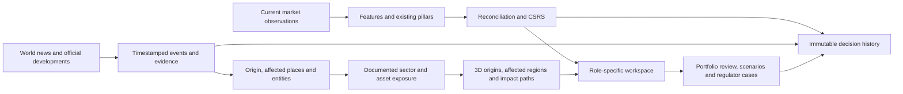

# Independent SERAPH product-readiness audit — 2026-10-16

**Assessment: substantial research and backend engineering exists; the intended live risk product is not engineering-complete.** The principal missing work is integration, operational state management, and usable workflows. Improving predictive accuracy alone will not close these gaps.

This audit follows the owner's clarified intent: worldwide developments should become evidence-linked signals, identify their origin and affected Indian sectors/assets, update the 3D map, and support distinct retail, institutional, and regulator workflows alongside the existing quantitative engine. Historical replay should help build and inspect that product, rather than define its only operating mode.

No scientific implementation, model eligibility, weights, thresholds, historical evidence, or application source was changed during this audit. Added files are audit scripts, observations and this report. Existing uncommitted work was preserved. No commits, publication, notifications, or source-database writes were performed.

## Evidence and scope

- Read the Astra amendments before interpreting the historical specification. Traced the canonical launchers, dashboard, bridge, dispatch, live loop, original/Astra model paths, persistence, identity, news, decision support, operations and tests.
- Catalogued and parsed **106 application Python files**, plus scripts, fixtures and tests. The inventory includes source hashes and imports. This is an engineering and integration audit, not an independent derivation of every numerical formula.
- Re-ran the core suite: **843 passed, 14 skipped, 1 expected failure**, in 109.22 seconds. Four expensive Hamilton/policy modules were deliberately excluded; their earlier reported results were not presented as new verification. Database/corpus checks remained skipped, so this run does not establish PostgreSQL integration.
- All five mechanical invariant checks passed. Whole-tree `git diff --check` found pre-existing trailing whitespace at `scripts/diagnose_jump_process.py:58`; it was not changed.
- Exercised the actual Streamlit component in headless Edge against an isolated SQLite copy, including all three role buttons and the same-role timeout. The repeat browser run exited successfully after audit-harness cleanup was corrected.
- Ran isolated synthetic probes for publication, late bars, volume, timestamps, authorization and news interpretation. Synthetic results are software evidence only.
- Inspected the existing news store read-only; projections ran against a temporary copy. No new external-news fetch or broker connection was attempted.

Evidence: [runtime probes and source inventory](evidence/INDEPENDENT-READINESS-2026-10-16.json), [browser observations](evidence/INDEPENDENT-BROWSER-RECHECK-2026-10-16.json), [browser capture](evidence/INDEPENDENT-BROWSER-RECHECK-2026-10-16.png), [news probes](evidence/INDEPENDENT-NEWS-2026-10-16.json), and `test-results/independent-readiness-audit.xml`.

## What the intended product requires

The two information channels should meet in a coherent decision workspace while retaining their own meaning and provenance:



For example, a foreign export restriction should identify the issuing country, announcement and effective dates, commodity, exposed Indian industries and documented dependencies. An Indian plant incident should locate the facility, rather than the company's headquarters. Selecting a map path should explain its evidence, affected assets, impact direction, uncertainty and age. Geography and economic sectors are different dimensions: sectors span places, and a place can contain several sectors.

The existing science can remain unchanged. News-derived significance should remain separately attributed; it need not be silently inserted into Hawkes/RMT/Hamilton or presented as a calibrated loss probability. The missing origin-to-impact plumbing is engineering work even while significance quality remains provisional.

## How much is actually done

“Implemented” below means usable code exists. “Connected” means the canonical product calls it. “Operational” would require exercised live inputs and recovery, not just unit tests.

| Area | Implemented and evidenced | Missing for the intended product |
|---|---|---|
| C1 storage | PostgreSQL schema, typed readers, idempotent writes/COPY; substantial SQLite run persistence | Exercised PostgreSQL integration, deployed migration path, live observation/decision recovery |
| C2 ingestion | Historical market clients; macro/flow parsers; bhavcopy and tariff loaders | Complete scheduled current-data refresh with freshness, gap repair and verified source coverage |
| C3 universe | Listing-age/ranking logic, classification controls and snapshots | Operational current membership and fully correct historical membership use in downstream writers |
| C4 features | Jump/state/cross-sectional derivation, causal-bin and alignment repairs | Incremental live feature state and corrected-corpus regeneration evidence |
| C5–C7 pillars | Real Hawkes, RMT and Hamilton implementations; separate Astra variants | Runtime adapters, warm starts, fit deployment, cadence handling and live failure recovery |
| C8–C9 reconciliation/fusion | Tested numerical components, missingness handling, pure scoring and decomposition | A timestamp-driven live application that actually invokes and persists them |
| C10 validation | Chronological research, baseline comparisons, ablations and preserved negative results | Unresolved FR35 design, live prospective ledger and production acceptance evidence |
| C11 decision support | Explanations, coverage arithmetic, rank-shock/regime-path tools, action log; newer workspace/scenario/case stores | Newer stores are not wired into the console; measured sector coverage, evaluated playbooks and fitted policy utility remain incomplete |
| C12 dashboard | Attractive globe; historical scores; role-based field projection; several functional tools | Role landing pages, authenticated workspaces, current data selection, news/map integration and automatic live updates |
| News acquisition | RSS/HTTP acquisition and a real local store containing 30 stories from three RBI feeds | Broad world-event coverage, operating freshness guarantees and a connected signal feed |
| News interpretation/map | Extraction, exposure graph, impact descriptors and overlay builder | Populated reference data, origin/facility extraction, trustworthy corroboration and actual renderer consumption |
| Identity | Grant, scope, membership and session machinery with tests | Login integration and per-request authorization on the running app; stale-principal defect needs correction |
| Operations | Job/health/alert-ledger building blocks | Complete scheduled pipeline, delivery adapter, recovery exercises, live latency/load measurements |

There is no defensible single completion percentage. A large fraction of the libraries exists, while several essential user journeys have no end-to-end implementation. Counting test cases or files would substantially overstate product completion.

## Principal findings

### R01 — P0: the live entry point does not invoke the risk engine

`scripts/run_live.py:44–47` constructs `LiveLoop(feed, clock=MarketClock())` without `evaluate` or `on_decision`. The CLI therefore supplies neither scoring nor a publisher. Credentials would enable a source connection, but would not complete CSRS computation or dashboard delivery.

The existing inference adapter is not ready to drop into that slot: `InferenceSession.step()` accepts strictly increasing **dates** and derives a session decision timestamp (`seraph/orchestration/prototype.py:84`). It cannot simply be called repeatedly for five-minute decisions on one date. The source endpoint deliberately withholds its composite because chronological standardization warmup is missing (`prototype.py:342`).

**Completion check:** the supported entry point processes timestamped bars through unchanged feature/pillar/reconciliation/fusion code, persists a typed result and makes that exact result visible in the dashboard. A raw-data replay and live adapter must share this path.

### R02 — P0: publication gates can claim currency without a score or live provenance

`seraph/live/loop.py:152` checks recency and `feed.is_live`, but not a successful CSRS result. A synthetic live-capable feed produced **`publishable=true`, `csrs=null`** with no evaluator installed. Connection health and complete input coverage are not sufficient publication conditions here either.

`console_backend.liveness_of()` uses the evaluation timestamp rather than verified feed/input provenance (`seraph/dashboard/console_backend.py:18`). A synthetic recent archive point displayed **CURRENT MARKET READING** while its own payload said no feed was configured. `MarketClock.recency()` also accepts a future timestamp as live; the probe returned age **−1435 minutes** and permission to publish.

**Completion check:** no score, future inputs, disconnected/unverified provenance and missing mandatory input coverage all fail publication explicitly. Current evaluation time cannot substitute for observation age.

### R03 — P1: bar finality and volume accounting fail at boundaries

`BarBuilder.close_elapsed()` removes a closed accumulator but retains no finalization watermark (`seraph/live/bars.py:133`). A late tick can recreate and re-emit the same closed window. The probe emitted the 11:00–11:05 bar twice, first with close 100 and then 999, while `late_ticks` stayed zero. The existing test covers late ticks only while a newer accumulator exists.

Volume uses the first and last cumulative totals within each bar (`bars.py:81`). With prior cumulative volume 150 and next-bar ticks 170 and 200, it reports 30 rather than the observed cross-boundary increment 50. Missing opening coverage also needs an explicit convention.

**Completion check:** finalized windows cannot reopen; cumulative-volume continuity, session resets, duplicate/out-of-order ticks and restart behavior are tested across several consecutive bars.

### R04 — P1: the live service has no recoverable scoring state or complete session lifecycle

Bars and decision history live in memory; no model/standardization/filter checkpoint or persisted input cursor is restored by `run_live.py`. Its `--once` mode constructs a new asynchronous connection and immediately polls it, making it unsuitable as a complete bar job. Its continuous loop checks session closure before draining the final bar. Job checkpoints contain only a decision timestamp and are cleared after success; they are not inference recovery.

The calendar defaults to weekdays plus selected special sessions, not a complete holiday calendar. `next_open()` examines each day's first window, so a split-session break needs additional handling. `LiveLoop.decisions` also grows without a retention bound.

**Completion check:** cold start, session close, disconnect/reconnect, token expiry, holiday/split session, backlog and restart are exercised without lost or duplicate decisions. Credentials are needed for a real feed test; the recovery implementation itself need not wait for them.

### R05 — P1: role buttons change projection but do not open role workspaces

The browser confirmed all three role requests reach Python and change the role. However, `bridge.js` initializes `active='map'` and always returns to `show(active)` after a response (`:17`, `:113`, `:146`). All three clicks left the map visible and no role page open.

Tools exist under a separate tab: coverage for all roles, shocks for professional roles, and regime paths/action logging for regulators. Those are useful partial capabilities, not the planned retail/institutional/regulatory experiences.

A second defect is reproducible: clicking the already-active role never satisfies the “role changed” acknowledgement (`bridge.js:126`). It times out after 15 seconds and blocks further requests until cancelled; the status/recovery controls live inside Tools, so the problem is particularly opaque on the map.

**Completion check:** each role has an explicit landing route and reachable utility; same-role clicks are harmless; every request has a visible, request-ID-bound acknowledgement across all views.

### R06 — P0 before multiuser use: authentication and owned workflows are bypassed

`prototype_app.py:62–91` accepts a role from session state/client requests, lists complete runs globally and stores portfolio calculations in session state. Neither the app nor console backend invokes `IdentityRegistry`, `WorkspaceStore`, `ScenarioStore` or `CaseStore`. Configuring an OIDC provider alone will not connect them.

Thus the newer portfolio import/history, scenario review and regulator case features are backend libraries, not delivered frontend workflows. The current action actor is a role string; it does not establish which authenticated person acted.

There is also a reproducible library defect: after revoking a grant, an existing `Principal` still passes `IdentityRegistry.can()` and can read a portfolio. Fresh `resolve()` correctly denies it, but `can()`/`require()` do not revalidate the cached principal (`seraph/identity/registry.py:311`). The integration must resolve current identity per request, and the service boundary must define/enforce that freshness.

**Completion check:** real login → server grant → owned workspace → permitted operation → durable actor audit, including revocation between two requests and cross-organisation denial.

### R07 — P1: real news is stored but not connected to the signal feed or map

At inspection the existing store held **30 stories, 30 observations and six ingest-log entries**, from RBI press releases, notifications and speeches. The latest first-seen timestamp was **2026-10-16 19:38:38 IST**. These are local records, not a new external-source verification by this audit. At 22:06 IST one source had exceeded its configured freshness budget.

`build_news_payload()` exists (`seraph/dashboard/news_view.py:218`), but the canonical app/backend/bridge never calls or consumes it. `console_backend.py:94` hardcodes the fabricated-news status. The frontend continues to use static signals, map relationships, commodities, weather and exposure previews.

Running the builder on a store copy produced a real **signals** surface but preview status for **sector stress, geography and assets**. Three RBI feeds also do not provide the worldwide developments coverage envisioned by the owner.

**Completion check:** a newly acquired article reaches the actual signal feed automatically with source, publication/first-seen times, freshness and stable event identity; outages cannot leave it looking current. Add source families according to event/geographic coverage, rather than treating one institution's feeds as global coverage.

### R08 — P1: the event-origin-to-Indian-sector graph is not populated or fully extracted

The default registry reports **0 entities, 0 places, 0 assets and 0 exposure edges**. Without those inputs the map cannot generate evidenced origin-to-target paths. Reference-data acquisition and curation are part of delivery, not something a renderer can invent.

The gap is also in code: `extract()` initializes an empty actor list and resolves entity names only (`seraph/news/extraction.py:180–183`). It does not invoke the asset resolver or resolve place mentions into an origin. In a synthetic headline about Tata Steel halting at Kalinganagar in Odisha, with all three registered, it resolved the company but neither the facility nor place. Direct `resolve_asset('Kalinganagar')` succeeded, demonstrating missing integration rather than missing test reference data.

`geography_overlay()` emits graph identifiers, but the production globe has no adapter consuming that overlay and resolving the identifiers into the visible regional/sector geometry.

**Completion check:** both an international event and an Indian facility event produce the correct source location and evidenced affected targets on the real globe. Unknown locations remain unresolved; sectors are not treated as geographic points. Clicking a path opens its cited mechanism and evidence.

### R09 — P1: news significance is an initial rule system, with correctness gaps

`Event.confirmations` counts distinct **story IDs**, despite describing distinct sources (`seraph/news/model.py:222`). Ten same-source synthetic copies returned ten confirmations. Confidence logic uses that count. Syndication clustering alone therefore does not satisfy the contract that copies are not independent corroboration.

Direction is fixed by event category (`seraph/news/estimation.py:170`). Synthetic repo-rate cuts and hikes both become `adverse`; there is no target-specific economic interpretation. Severity and horizons are type/quantity rules, not a measured sector-impact model. This does not demand immediate predictive research, but the UI must expose the assumptions and avoid representing this as a completed causal propagation engine.

**Completion check:** distinguish independent evidence from syndication/corrections, extract origin/action/affected target, and support explicit unresolved/ambiguous impact. Preserve rule versions and analyst review; later improvements in warning confidence can build on those records.

### R10 — P1: portfolio, institutional and regulator utility is partial

- Portfolio dispatch always supplies an empty sector-flag mapping (`console_backend.py:128`), so coverage calculations cannot demonstrate measured sector risk. Durable holdings and historical snapshots exist in `WorkspaceStore` but are unused here.
- Scenario dispatch calls real C11/C9 arithmetic, but does not use the newer saved scenario/review workflow. Rank shocks are not economic price shocks.
- The playbook is template guidance without measured drawdown reductions.
- Regulator policy UI accepts hypothetical regime probabilities; it is not the fitted macro-path simulator. Institution decomposition is an unfilled gateway field; no authorized institution submissions are available.
- The action journal works locally, but case assignment, evidence review and closure are not integrated into the console.

**Completion check:** each role completes a useful durable journey through the actual UI. Existing modules should be reused; unavailable model/data capabilities should have explicit states rather than fabricated outputs.

### R11 — P1: Hawkes historical basket metadata does not govern the fitted stream

Static tracing of `scripts/write_hawkes_production.py` found that it chooses a basket at `corpus_end` (`:180`), builds symbols and loads one pooled stream (`:195`), and fits window slices of that stream. It only then resolves `window_basket` (`:236`) for artifact metadata. It does not rebuild the window counts from that basket.

Consequently, declaring a point-in-time basket in the artifact does not make the underlying historical count stream point-in-time. Historical members absent from the terminal basket are unavailable to those fits. This is an input/provenance defect, not a request to change Hawkes mathematics. It was identified by code tracing, not a new database fit.

**Completion check:** use a changing-universe fixture where an old constituent exits and a new one enters; verify actual per-window input symbols/counts and recorded basket identity agree.

### R12 — P1: operational building blocks do not yet constitute a running service

Job leases/checkpoints, health functions and an alert ledger are present. They are not a complete market → feature → pillar → score → UI schedule. The dashboard reads completed historical runs and does not subscribe/poll an incremental live-result store. Cache TTL is not automatic browser refresh.

No delivery transport connects CSRS alert crossings to users. Backup/restore is documented rather than demonstrated. The source schema bootstrap does not invoke the new migration runner; its application must be part of a supported deployment procedure and verified on a disposable database. Live bar-close-to-screen latency and concurrent-user performance have not been established by this audit or by the passing unit suite.

**Completion check:** operate a supervised session, record freshness and failure states, restart it, verify durable outputs, exercise backup/restore, and measure ingestion-to-render latency. Keep the specification's hypothetical uptime target separate from demonstrated acceptance.

## Why the existing status documents overstate readiness

Many `verified` rows accurately describe passing library tests, but they are easy to read as completed product capabilities. Examples are AUTH02/AUTH04, NEWS06, SCEN01 and CASE01: their code is present, while the canonical route bypasses it. LIVE04's test injects a lambda returning `0.42`; it proves callback mechanics, not execution of the production risk pipeline.

The status register also contains stale assertions: it says no news has been fetched, while a local store now contains fetched stories. Its summary labels “verified” as 25 but lists 27 IDs. The source-to-screen inventory still describes some already-repaired transport/cache defects. These inconsistencies make it unsuitable as the sole completion measure.

Use separate columns for **implemented**, **integrated into the supported entry point**, **verified against real input**, and **operationally accepted**. A feature is complete only when the relevant user journey passes. Scientific acceptance remains its own column.

## Completion sequence with reviewable gates

| Order | Deliverable | Acceptance gate | External dependency |
|---|---|---|---|
| 1 | Correct live gates, bar finality, event time and role request lifecycle | Reproductions R02/R03/R05 fail closed or behave correctly; ordinary clicks never stall | None |
| 2 | One timestamp-based inference service around the existing science | Same recorded inputs through replay and incremental adapters yield equivalent eligible outputs; cadence and missingness preserved | No credentials needed to build/test; real corpus needed for historical equivalence evidence |
| 3 | Durable live observations, state recovery, result reader and UI refresh | Restart between bars; no duplicate/lost decision; final session bar appears; screen shows source age | Database/service availability for integration verification |
| 4 | Actual retail/institutional/regulator routes and service wiring | Holdings survive restart; scenarios save/reopen; regulator case can be assigned, reviewed and closed; existing journal retained | OIDC provider for real login; institution data only for institution-specific views |
| 5 | First news-to-globe vertical slice | New sourced event → dedup → origin/affected asset → documented sector dependency → visible path → evidence detail → role action | Reachable sources and cited reference data; no new quantitative model required |
| 6 | Broaden news and geography coverage | Coverage matrix by event family/country/sector; stale feeds visible; ambiguity and corrections handled; reviewed extraction examples | Source access/rights and reference-data coverage |
| 7 | Operated shadow session and recovery/release exercise | Real inputs, persisted decisions, UI latency, faults, token expiry, backup/restore and alert lifecycle demonstrated | Broker credentials, reachable storage, selected deployment audience |

Model confidence, scientific comparisons and refined economic impact estimation can then improve against an intact prospective record. They should not be used as reasons to defer ordinary navigation, authentication, persistence, ingestion or rendering work.

The first news slice should include both a foreign-origin event and an Indian local incident, because those exercise the two map behaviors the owner specifically described. A static demo article is useful for deterministic testing, but delivery requires a received article traveling through that same path.

## Reproduction

The added audit scripts do not repair the application. They make the gaps reviewable:

```powershell
.\.venv\Scripts\python.exe scripts/audit_product_readiness.py docs/evidence/NEW-RUNTIME-AUDIT.json
.\.venv\Scripts\python.exe scripts/audit_news_readiness.py docs/evidence/NEW-NEWS-AUDIT.json
.\.venv\Scripts\python.exe scripts/audit_console_browser.py docs/evidence/NEW-BROWSER-AUDIT.json
```

All scripts refuse to overwrite existing evidence; pass a fresh output path when repeating them. The browser script creates an isolated application/store/browser session. The first browser run captured valid observations but encountered a Windows temporary-file cleanup error; those observations were preserved, the harness was repaired, and the separate repeat completed with exit code zero.

Audit outcome: **a tested research foundation with partially integrated product features, not a complete live risk-and-event intelligence platform.** The next engineering work should connect and verify the user journeys above while keeping the scientific baseline intact.
