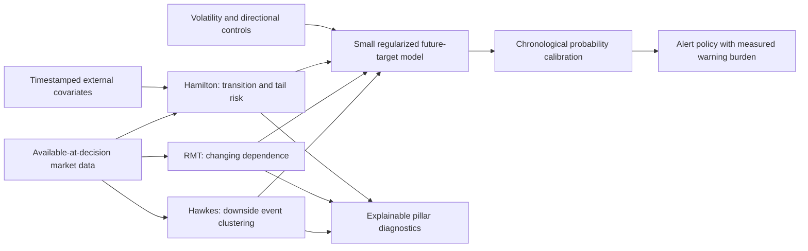

# SERAPH scientific audit and prediction research plan

**18 October 2026 · Hawkes, RMT and Hamilton retained · retrospective research**

## 1. Research judgment

**The three families are defensible components of a conditional market-risk
system. Their current combination has not demonstrated dependable advance
crisis prediction.** Keep all three, but improve their information, timescales,
and forecast interpretation before adding model complexity. No scientifically
defensible adjustment can promise a particular accuracy on future crises.

The recommended direction is a **three-pillar forecast of specified future
market losses**, accompanied by a separately evaluated onset-warning model and
clearly attributed external-event context. Preserve the original onset
question; success on losses must never be substituted for success on onset.

This audit inspected the specifications and experimental amendments, original
and daily research pillar implementations, feature construction, reconciliation,
fusion, calibration, evaluation, and relevant runtime boundaries. It verified
the saved research hashes, recomputed metrics, ran mathematical counterexamples,
and evaluated **ten diagnostic configurations on each of two targets**. Eighteen
supervised configurations were fitted; two were causal frequency forecasts.
The candidate list was written before these new calculations, after reading
the previous results. It is **not** an untouched or historically preregistered
experiment. Production models, shared types, existing evidence, and pre-existing
working-tree edits were left unchanged. No database writes or new vendor data
were involved.

Read [the fixed audit protocol](evidence/scientific-audit-2026-10-18/PLAN.md),
[reproduction code](evidence/scientific-audit-2026-10-18/audit.py), and
[complete experiment results](evidence/scientific-audit-2026-10-18/experiment/metrics.csv).
The [18 findings are also available as CSV](evidence/scientific-audit-2026-10-18/findings.csv).

## 2. What the measurements establish

### Existing experiment, independently recomputed

Data: **5,361 sessions, 2005-01-03 through 2026-08-21**. Common probability
assessment: **4,576 sessions**. The target market series is the mean log return
of available universe members. It is neither an official NIFTY index nor the
return of an executable equally weighted portfolio.

| Future target | Predictor | Brier ↓ | AUROC ↑ | Average precision ↑ |
|---|---|---:|---:|---:|
| 10% close-to-future-close loss within 15 sessions | Mature historical frequency | 0.072005 | 0.599139 | 0.107650 |
| Same | EWMA volatility logistic | 0.069802 | 0.654774 | 0.153620 |
| Same | EWMA + all three pillars | 0.069543 | 0.658795 | 0.173891 |
| Named onset within 15 sessions | Mature historical frequency | 0.019452 | 0.310633 | 0.015878 |
| Same | EWMA volatility logistic | 0.019450 | 0.348794 | 0.014254 |
| Same | EWMA + all three pillars | 0.019499 | 0.269148 | 0.012500 |

The frequency model uses only matured labels, with the same initial training
count and refit cadence. It is not the full-sample prevalence disguised as an
available forecast. Its changing probability can have an AUROC different from
0.5; only a constant score necessarily has AUROC 0.5 on a two-class sample.

The combined loss model improves Brier by **0.000258**, about **0.37% relative**
to volatility logistic. The descriptive 63-session paired bootstrap interval
is **[−0.001928, +0.001085]**, where negative favors combined. The 21- and
126-session intervals also cross zero. This is insufficient evidence of an
incremental forecasting advantage. The onset model is worse in both ranking
and Brier; its tiny differences must be understood against extreme imbalance.

The combined onset policy warns **0 of 4 assessable non-tariff project events**:
taper, IL&FS, COVID, and tightening. GFC lacks sufficient alert-calibration
history. The tariff placeholder is also missed but is not valid confirmation
evidence. All other project onset dates remain provisional too.

On common coverage, positive days are **7.69%** for losses and **1.97%** for
onsets. Always predicting no onset would therefore earn **98.03% accuracy**.
That is why ordinary accuracy is the wrong headline. Average precision and
event recall at an explicit warning burden complement AUROC; none alone
establishes calibration. [Saito and Rehmsmeier](https://journals.plos.org/plosone/article?id=10.1371/journal.pone.0118432)
explain the precision-recall problem under class imbalance.

Evidence: [existing metrics](evidence/scientific-audit-2026-10-18/existing-metrics.csv),
[events](evidence/scientific-audit-2026-10-18/existing-event-warnings.csv),
[intervals and probes](evidence/scientific-audit-2026-10-18/diagnostics.json).

### New, bounded sensitivity experiment

All thresholds still use past out-of-sample forecasts and matured labels, with
the existing calibration constraints of two false episodes/year and 10% warning
time. These are historical calibration constraints, not future guarantees.

| Loss predictor | Brier ↓ | AUROC ↑ | False episodes/year | Warning time |
|---|---:|---:|---:|---:|
| Original volatility baseline | 0.069802 | 0.654774 | 0.994 | 5.82% |
| Original combined | 0.069543 | 0.658795 | 1.462 | 2.46% |
| Baseline, weaker shrinkage C=1 | 0.069781 | 0.646673 | 1.111 | 6.03% |
| Combined, weaker shrinkage C=1 | 0.070309 | 0.634135 | 0.877 | 2.83% |
| Baseline, trailing five-year training | 0.068838 | 0.628625 | 0.175 | 7.75% |
| Combined, trailing five-year training | 0.068873 | 0.645194 | 1.520 | 2.81% |
| Combined + Hawkes × spectral-change interaction | 0.069680 | 0.658508 | 1.286 | 2.48% |
| Volatility + past 20-session return + downside breadth | 0.068719 | 0.687881 | 1.286 | 1.39% |
| That context + all three pillars | 0.068810 | 0.678187 | 1.520 | 1.44% |

The omitted frequency row is in the complete results: Brier 0.072005, zero loss
alerts. Every configuration and both targets are preserved, including failures.
All loss-model matched combined-versus-baseline intervals cross zero. More
regularization freedom and the one interaction did not solve the problem.
The stronger context baseline outperformed its own three-pillar extension in
aggregate Brier. This does not justify deleting pillars; it sets a stronger
benchmark their redesigned features must beat.

There is one **interesting but limited positive observation**. The trailing
five-year combined **loss** policy has active warnings within the pre-onset
windows for COVID and tightening, dated 2020-01-30 and 2021-12-20 by the
existing window-scoring rule. It still misses taper and IL&FS. Its matched
volatility baseline has slightly better overall Brier, and every tested
three-pillar **onset** model still warns 0/4.

Do not advertise the two loss-policy overlaps as successful crisis forecasts:

- The COVID alarm episode actually began **2020-01-21**, before the fixed
  15-session onset window. January 30 is the first active day *inside* that
  window, not a new alarm. The episode ends February 10; only its last three
  decision days have positive loss10_15 labels. The policy is off immediately
  before the February 20 onset.
- The December 20, 2021 alarm is a single day with **loss10_15 = 0**. It is a
  false alarm for the forecast's stated loss target even though it falls before
  the separately chosen tightening label.
- This variant was evaluated after the crises and earlier failures were known.
  Neither the apparent hits nor the numerical gain are prospective evidence.

The lesson is to investigate adaptation to changing base rates, while keeping
target-specific success, active-warning coverage, episode starts, and alarm
persistence separate. The original combined model predicts an average **7.20%**
loss probability during 2023 onward versus **1.47%** realized positive decision
days. Five-year training reduces its average to **4.95%**, still too high.
This is concrete calibration drift, not a reason to select a hindsight threshold.

Evidence: [all forecasts](evidence/scientific-audit-2026-10-18/experiment/predictions.parquet),
[fits and cutoffs](evidence/scientific-audit-2026-10-18/experiment/fit-audit.json),
[actual alarm episodes](evidence/scientific-audit-2026-10-18/experiment/episodes.csv),
[era results](evidence/scientific-audit-2026-10-18/experiment/era-metrics.csv),
[reliability bins](evidence/scientific-audit-2026-10-18/experiment/reliability.csv).
`summary.json` also reports assessment before the unresolved tariff window;
this sensitivity does not relabel its positive days as negatives.

## 3. Findings ranked by scientific consequence

| ID | Priority / status | Finding and affected path | Required response |
|---|---|---|---|
| S01 | P0 · Confirmed design mismatch | Original CSRS ranks current stress. Original evaluation labels the 30 sessions **after** breaks. Neither is inherently a forecast of the preceding onset window. | Define and score future-target probabilities separately; retain CSRS as a diagnostic. |
| S02 | P0 · Reproduced defect | Original batched Hamilton filtering recomputes the emission variance floor from a sample containing the rest of the forecast block. Future values can change earlier filtered probabilities. | Freeze every preprocessing/regularization statistic at training cutoff; add full-pipeline suffix-perturbation regression before trusting that path. |
| S03 | P0 · Confirmed metric defect | Legacy `mean_lead_time` credits the earliest threshold crossing anywhere before an onset, without a bounded window or actual persistence test. | Replace predictive reporting with explicit event-window matching, misses, and episode starts. |
| S04 | P0 · Confirmed objective limitation | CSRS's linear asymmetric calibration is not a proper probability loss and favors extreme simplex allocations. | Fit probabilities with proper scoring loss; apply action costs to the alert policy. |
| S05 | P0 · Evidence limit | Six remembered labels, one unresolved; four assessable non-tariff alert events. Related daily labels are not independent crises. | Freeze objective event definitions and a new evaluation protocol; preserve named events as case studies. |
| S06 | P1 · Measured | Combined loss calibration drifts and pillars show little incremental value beyond stronger baselines. | Evaluate adaptive calibration and matched baseline comparisons before new complexity. |
| S07 | P1 · Mathematical counterexample | MP exceedance fraction can decrease when the market becomes more dominated by one common mode. Gaussian independence p-values are not crisis probabilities. | Separate dependence detection from instability; prioritize conditional spectral changes on an appropriate null. |
| S08 | P1 · Measured representation weakness | Daily RMT averages stocks into ten hash portfolios; median fast leading share is 0.842. This differs substantially from the 500-stock pillar. | Rebuild fast/slow constituent or economic-sector panels, alongside the retained original estimator. |
| S09 | P1 · Inherited empirical limit | Original Hawkes excitation has approximately one-bar half-life in the prior study; it does not establish 15-session warning skill. Changed jump extraction has not regenerated that evidence. | Re-estimate corrected streams and test horizon-specific intensity/mark features. |
| S10 | P1 · Confirmed assumption risk | Pooled jump signs are dependent; the downside gate uses an independent-binomial null and an estimated baseline treated as fixed. | Validate by session-cluster resampling or a suitable overdispersed model; report continuous evidence rather than relying on a hard gate. |
| S11 | P1 · Measured fit weakness | Daily Hamilton has 7 nonconverged fits out of 82; minimum fitted state occupancy is 0.58%. High-volatility state is not a named-crisis probability. | Introduce declared convergence/identification eligibility and tail-aware forecasts. |
| S12 | P1 · Confirmed uncertainty limit | Conditional CSRS `a'Pa` is repaired, but uncertainty in weights, regime probabilities, ECDF reference distributions, and parameters is not included. Default diagonal filter does not estimate cross-pillar dependence. | Validate uncertainty against its actual estimand; do not label the interval a future-loss interval. |
| S13 | P1 · Data/provenance limit | Snapshot is not an as-published archive; membership coverage varies from 212 to 500; synthetic target is not the official market index. | Build an immutable target/input ledger with publication times, membership, adjustments, and coverage. |
| S14 | P1 · Policy limitation | Existing episode scoring rewards any overlap with a positive day. One long alert can cover events and many unhelpful days. Calibration budgets are exceeded in onset replay. | Evaluate fresh alerts, active coverage, duration, precision, costs, and misses jointly. |
| S15 | P2 · Mathematical correction | `ln(2)/(1-p)` is an approximation to a constant-transition spell half-life, not a general liquidity-recovery forecast. | Report exact spell-duration quantities or a specified first-passage forecast. |
| S16 | P2 · Confirmed API risk | Original Hamilton's default `fit()`/auto-fit uses smoothing. Causal callers must select and fit correctly. | Make diagnostic versus forecast eligibility explicit at the boundary; preserve historical smoothed artifacts as descriptive only. |
| S17 | P2 · Reproduced initialization defect | Original Hamilton draws constant-transition restarts as if their parameters were unconstrained logits. All four default-seed draws imply invalid transition probabilities. | Construct legal simplex transitions, or draw in the actual unconstrained parameterization with the correct fit flag. |
| S18 | P1 · Source-confirmed eligibility risk | Original Hawkes returns a convergence flag that `estimate_state` does not check; original Hamilton can fall back to a nonconverged fit when every start fails. | Separate numerical fit status from usable emissions and record all failed/rejected attempts. |

P0 denotes invalid inference or an information-boundary defect, not a claim that
all current outputs are contaminated. In particular, **S02 is not in
`seraph/prediction/pillars.py`**, and S03 is not the newer
`seraph/prediction/evaluation.py` bounded event calculation. The current original
execution path also deliberately withholds Hamilton from scoring for scientific
eligibility reasons. Keep that exclusion until it is independently justified.

### S02: reproduced Hamilton look-ahead mechanism

[`MultivariateTVTPHamilton`](../seraph/pillars/hamilton/engine.py) sets
`_var_floor = 0.01 * variance(y)` in its constructor and clamps emission
variances to that floor. [`hamilton_causal.walk_forward`](../seraph/orchestration/hamilton_causal.py)
fits on `y[:t_k]`, but constructs the filtering model on `y[:emit_end]`.
Consequently an observation after decision t can raise a floor used at t.

The audit held legal training-only parameters fixed and changed only a future
suffix. Earlier filtered probabilities changed by up to **0.6667** in the
synthetic stress case. Copying the training floor into the filtering model
reduced that change to **0.0**. This proves a reachable information leak; it
does not measure the size of contamination on historical NSE fits. Reproduce
before fixing, retain the probe, then rerun affected original-path evidence.

### S03–S04: metric and objective derivations

The legacy lead-time probe has one alarm at session 1, an onset at session 100,
and no alarm during sessions 85–99. The function reports **99 sessions of
lead**. That does not satisfy a 15-session early-warning question.

For true event probability p and quoted score s, the expected old loss is

\[
E[L(s,Y)]=\kappa_m p(1-s)+\kappa_f(1-p)s.
\]

Its derivative is `κ_f(1−p)−κ_m p`; the optimum is s=0 or s=1, except at a
single indifferent probability. It is a decision preference, not probability
calibration. Under a fixed full mask and fixed regime probabilities, CSRS is
linear in the weight rows, so optimizing this objective over their simplexes
generally selects vertices. Softmax parameterization does not remove that
geometry. Mask renormalization complicates the objective, but does not make it
a proper score.

In the probe with ten positives among 100 outcomes and costs 10:1, predicting
the true rate 0.1 costs 99; always quoting 1 costs 90. The new logistic research
layer already avoids this defect. Proper probability scoring is grounded in
[Gneiting and Raftery](https://sites.stat.washington.edu/people/raftery/Research/PDF/Gneiting2007jasa.pdf).

Source locations: [legacy harness](../seraph/validation/harness.py),
[original post-break labels](../scripts/evaluate_csrs_research.py),
[new future labels and logistic model](../seraph/prediction/models.py).

## 4. Hawkes: preserve contagion, improve the observed process

The retained intraday mean is

\[
\lambda_t=\mu d_t+\alpha\sum_{k\ge1}\phi^{k-1}N_{t-k},
\qquad n=\frac{\alpha}{1-\phi}<1.
\]

It is a negative-binomial count model at five-minute resolution with excitation
reset at session open. This is appropriate to tied bar observations compared
with pretending that every jump has an exact distinct event time. Binned-count
approaches have a theoretical basis in
[Kirchner's Hawkes estimation research](https://arxiv.org/abs/1509.02017).
That does not make this particular negative-binomial/reset specification an
exact continuous-time Hawkes likelihood.

The historical finding `n ≈ 0.11` is useful evidence against forcing
near-criticality. The geometric kernel at `φ ≈ 0.5` has a one-bar half-life.
Its direct excitation disappears quickly and resets overnight. A changing
baseline or persistent latent vulnerability might still forecast daily losses;
that must be measured separately. `n/(1−n)` is an infinite-horizon stationary
cluster amplification interpretation under appropriate branching assumptions,
not a literal expected remaining daily loss with finite session resets.

The daily research extension is a different quasi-Poisson tail-count model with
fixed five-session kernel half-life. Its 81 fitted windows include seven with
zero excitation; the minimum is nine observed training tail events. Preserve
valid zero estimates. Minimum event eligibility is not proof of identification.

Recommended work, in order:

1. **Rebuild the corrected event stream.** Version Lee–Mykland normalization,
   multiplicity, session/overnight handling, missing-bar rules, and basket
   membership. The original historical fit claims predate the corrected jump
   flags. The extractor also converts invalid-price returns into zero; callers
   must distinguish missingness from a genuine quiet bar before using it.
2. **Model exposure and baseline first.** Number of observable symbols, time of
   day, common market volatility, and session changes can alter counts without
   stronger contagion. Use a fixed basket or explicit exposure model; verify
   that its normalization does not create apparent persistence.
3. **Test the finite-horizon forecast, not only n.** Candidate outputs are
   expected downside counts over the next 1/5/15 sessions, intensity relative
   to baseline, and downside-event magnitude. Estimate intraday versus daily
   memory on training data; do not impose slow memory to make it predictive.
4. **Use parsimonious marked/sector variants only if identified.** Start with
   a few stable economic sectors and shrink excitation parameters toward a
   pooled model. Sparse/low-rank Hawkes estimation is supported by
   [Bacry et al.](https://arxiv.org/abs/1501.00725); its transfer to this binned,
   low-count panel requires testing. Do not pretend hash buckets are sectors.
5. **Test fit and stability.** Out-of-sample count log score, dispersion,
   randomized count PIT/residual autocorrelation, parameter bounds, multi-start
   stability, and null simulations with shifting Poisson/NB baselines should
   precede crisis claims. Simulate the whole estimation procedure when
   calibrating residual tests after fitting.

The independent-binomial downside gate does not account for simultaneous market
jumps, temporal clustering, or uncertainty in its fitted reference share.
A session-cluster bootstrap or overdispersed signed-count model is a research
candidate. Estimate its baseline strictly before the forecast block. Keep n,
downside mix, and gate evidence separately visible; a closed gate is not zero
contagion. The current original adapter already carries ungated branching-based
stress, so this gate issue does not explain the daily experiment's results.

If positive-to-negative inhibition is introduced, negative coefficients in an
otherwise linear intensity may make it invalid. A positive-link nonlinear
model needs its own stability and interpretation; a signed-kernel number is
not automatically the usual branching ratio. Do not claim the currently empty
branching matrix is a calibrated sector transmission network.

[Filimonov and Sornette](https://arxiv.org/abs/1308.6756) demonstrate that changes
in baseline regime can produce apparent Hawkes criticality without actual
self-excitation. This directly motivates the baseline and null checks above;
it does not prove every SERAPH Hawkes estimate is spurious.

## 5. RMT: forecast changes in dependence, not rejection of independence

The original estimator has useful repairs: consistent correlation scaling,
actual `T/N`, and sign-invariant leading-vector overlap on common support.
However, its 1,000-session window estimates a slow structure. It is not a
natural sole detector of a new 5–15-session dependence change. The new daily
model's 60/252-session comparison already addresses speed, but on ten highly
diversified portfolios that suppress much of the stock-level information.

In the saved daily features, the fast leading-share median is **0.842**, and
the theoretical ceiling after 10% identity shrinkage with ten columns is
**0.91**. Its Spearman correlation with EWMA volatility is **0.613**;
Hamilton next volatility's correlation with EWMA is **0.784**. These are
descriptive correlations, not proofs of redundant conditional information.
They make stronger baseline tests essential.

The MP upper edge

\[
\lambda_+=(1+\sqrt{N/T})^2
\]

is a null benchmark under specific assumptions. Financial dependence,
heteroskedasticity, temporal dependence and shrinkage change the problem. The
original Gaussian bootstrap tests independence; an ordinary factor-driven bull
market can reject that null. A small p-value is not evidence of an imminent
crisis. RMT's financial applications and extensions are reviewed by
[Bouchaud and Potters](https://arxiv.org/abs/0910.1205).

**Exact counterexample:** take N=100, T=200. Five independent 20-stock sectors
with within-sector correlation 0.25 have leading share 0.0575 and five MP
exceedances (`F=0.05`). Give every pair correlation 0.25: leading share rises
to 0.2575, but only one eigenvalue exceeds MP (`F=0.01`). Thus increasing
market-wide concentration can make F fall. This concerns F/SCA interpretation;
the current main original adapter uses leading share, and the daily research
forecast does not use F.

Recommended RMT challenger:

- Keep the original 1,000-session estimator as a slow reference. Compute
  a small predeclared fast/slow pair on actual point-in-time constituent or
  economic-sector returns. Use causal volatility standardization and stable
  common support. Record changing N, sector coverage, and stale prices.
- Test leading share and its fast-minus-slow change before adding many related
  eigenfeatures. A shrinkage estimator can improve covariance estimation;
  [Ledoit and Wolf](https://www.ledoit.net/Analytical_AoS_2020.pdf) provide an
  analytical nonlinear approach. Better covariance estimation is not itself
  evidence of better crisis prediction.
- Calibrate change statistics against a null that retains ordinary factors,
  volatility dynamics, marginal tails, missingness, and the exact estimation
  procedure. A block bootstrap preserving all observed co-movement is suitable
  for uncertainty around that co-movement, not automatically a null of no
  abnormal dependence. Define what is held fixed and what hypothesis is broken.
- Treat eigenvector rotation cautiously near a small eigengap: a nearly
  repeated eigenvalue has no stable unique leading direction. The daily
  extension handles exact ties; the original core lacks an equivalent guard.
  Projection/subspace distances are possible research amendments, not silent
  replacements of the current FR17 statistic.
- Never use the unshrunk MP edge as a calibrated significance threshold for a
  new shrunk estimator. Refit the null and revalidate its error rates.

## 6. Hamilton: forecast transitions and losses with identified states

For a row-stochastic transition matrix A, the daily model correctly uses

\[
\pi_{t|t}\propto (\pi_{t-1|t-1}A)\odot f(r_t),
\quad \pi_{t+1|t}=\pi_{t|t}A.
\]

Filtering is causal **conditional on parameters and preprocessing being fixed
from available data**. Smoothing inside a past training window for parameter
estimation is legitimate; emitting full-sample smoothed probabilities as
historical forecasts is not. Hamilton's
[regime-switching treatment](https://econweb.ucsd.edu/~jhamilton/palgrav1.pdf)
distinguishes inference using observations available at t from later information
and allows non-Gaussian emissions.

The daily Gaussian, zero-mean, constant-transition variant is a reasonable
small baseline, but it risks using states to approximate heavy-tailed returns
rather than economically persistent regimes. A high-volatility posterior can
rise only after a shock. The original three-variable model also has overlapping
realized-volatility/absorption/spread inputs with observation persistence and
measurement noise not captured by a diagonal independent-emission assumption.

Recommended sequence:

1. Repair and test S02; make training-derived scalers, variance floors,
   initializations, state ordering, and parameter versions immutable per block.
   Fix S17 as well: the original code's four default-seed constant-transition
   random starts produce negative entries and entries above one. These starts
   do not provide the intended valid multi-start exploration. This does not
   prove that the final selected fit is invalid. See the
   [reproduced transition ranges](evidence/scientific-audit-2026-10-18/supplement.json).
2. Compare Gaussian and parsimonious **Student-t** state emissions with
   train-only regularization, before adding full switching GARCH. Require
   convergence, adequate state support, and stable transition/variance
   estimates. A three-state fit's existence is not evidence that three states
   are identified. A two-state control is diagnostic, not removal of Hamilton.
3. Compare forecast features: next-horizon stress-entry probability, predicted
   tail loss, and stress persistence. Retain current filtered probabilities
   for explanation. Do not pass every simplex component plus LSD into a tiny
   supervised model as if they were independent signals.
4. Add only a small predeclared set of available-before-decision TVTP drivers:
   implied volatility context, credit/liquidity conditions, and relevant
   official-policy event measures. A credit-regime model has shown useful
   forecasting results in a different setting in
   [Li and Xiao](https://www.bankofcanada.ca/2016/04/staff-working-paper-2016-21/).
   That motivates a hypothesis; it does not transfer those results to NSE.

For a constant A and non-crisis submatrix Q, conditional on currently being in
a non-crisis state, the fitted-state entry probability by horizon h is

\[
P(\tau_C\le h\mid\mathcal F_t,S_t\notin C)
 =1-\widetilde\pi_{N,t} Q^h\mathbf1,
\]

where the non-crisis probabilities are renormalized to sum to one. With TVTP,
replace the power by the ordered product of future non-crisis transition
matrices. Unknown future covariates need a declared forecast or scenario,
never their subsequently observed values. This is a latent-state hitting
probability, still not the probability of the externally defined market-loss
event. Calibration to that target is a separate step.

For a constant stay probability p, no-exit survival is p^k. The real-valued
half-life is `log(0.5)/log(p)`; the first integer crossing uses a ceiling, and
expected geometric spell length is `1/(1−p)`. The current
`log(2)/(1−p)` is a near-one approximation: at p=0.5 it returns 1.386 rather
than 1. With TVTP, use products of stay probabilities. None of these is
automatically a liquidity-recovery time; recovery requires a specified target
state and may involve transitions through intermediate states and re-entry.

## 7. Fusion, uncertainty, and alert decisions

### Keep measurement separate from the forecast

The corrected CSRS variance `a'Pa`, with `a=Σ ξ_j w_j`, is right for a shared
uncertain pillar vector **conditional on fixed ξ and w**. The repaired Kalman
also correctly avoids fabricating observations from missing data or repeatedly
assimilating one vintage. These repairs should be retained.

There are remaining assumptions to validate:

- Default diagonal P and scalar independent-coordinate Q/measurement updates
  do not learn correlated pillar uncertainty, although all pillars use related
  market data. A full formula cannot recover off-diagonals the model never
  estimates.
- Hamilton's `Σ j²π_j − (Σ jπ_j)²` measures uncertainty about a latent state
  label conditional on fitted parameters. It is not the sampling variance of
  the fitted posterior mean. Passing it as measurement noise is a modeling
  convention, not established estimator precision.
- The emission-boundary ECDF variance mapping correctly avoids mixing raw and
  rank units, but its local delta approximation, numerical floors, and
  estimated reference distribution still need empirical validation. Hard
  ties, sparse tails, and changing reference windows can be material.
- Kalman Q/R and smoothing can delay useful changes. Compare raw causal
  features, forward fill, and reconciliation on identical forecasting folds.
  Lower noise in a chart is not necessarily better warning performance.
- The interval is not a loss interval or uncertainty band for crisis
  probability. The observed future loss cannot validate coverage of a latent
  CSRS state without an explicit measurement model and target definition.

### Recommended first forecast architecture



All three pillars remain named and evaluated. Controls and external information
do not require inventing a fourth pillar. Keep their incremental predictive
contribution separately accountable.

A parsimonious first model is

\[
\operatorname{logit}p_{t,h}=b_h+\beta_H H_t+\beta_R R_t+\beta_M M_t
 +\beta_z^\top z_t+\gamma H_tR_t.
\]

Use the interaction only as a preregistered challenger: the interaction tested
here did **not** establish improvement. Regime-dependent coefficients or a
mixture of experts need shrinkage toward shared coefficients; six freely
adaptive crisis-specific branches would be unsupported. Keep all three
families, while allowing the data to show that a fitted coefficient adds little.
Artificially enforcing positive influence would manufacture contribution.

Start with L2 logistic/log score and a chronologically fitted intercept/slope
calibrator. Compare expanding and bounded history using inner time splits.
Isotonic calibration can overfit sparse positives. Naive class weights change
the probability estimand; use them only with explicit correction and held-out
calibration, not as a shortcut to better recall.

For a one-decision cost model with false-warning cost C_FA and missed-event cost
C_M, warn when `p > C_FA/(C_FA+C_M)`. Real warning episodes have duration,
switching, hedge and delayed-execution costs; simulate that policy rather than
pretending the one-step formula solves it. Separate probability calibration
from policy utility and report both.

### A second-stage generative model, only if the simpler model earns it

An integrated simulator could use Hamilton for state transitions and
state-dependent returns, Hawkes for signed jump arrivals/marks, and RMT for
cross-asset dependence. Simulated paths then estimate the same specified
future-loss barrier probability. This preserves the economic roles of all three.

It is not the first implementation priority: state, GARCH and heavy tails can
double-count jumps unless the return decomposition is fitted coherently;
cross-asset tails require more than a cleaned linear correlation matrix; and
Monte Carlo error is only a small part of parameter/model uncertainty.
EVT on filtered innovations is a later benchmark, supported methodologically by
[McNeil and Frey](https://statmath.wu.ac.at/~frey/publications/evt-garch.pdf),
not a cure for scarce independent crises or uncertain labels.

## 8. The data and evaluation that could support a stronger claim

### Target and information ledger

Keep the original 15-session named-onset endpoint as a distinct question. For
the future-loss endpoint, explicitly define

\[
Y_{t,15}=1\{\min_{1\le k\le15}(P_{t+k}/P_t-1)\le-0.10\}.
\]

This is a loss from today's close, not maximum peak-to-trough drawdown and not
an intraday barrier. If decisions occur after close, executable strategy testing
must begin at a subsequently tradable price. Publish signal, receipt, forecast
and execution times separately.

For a new market-target experiment, use an official broad-market index or a
fully specified investable portfolio. Keep the synthetic-index experiment as
historical evidence; changing index changes the question. Independent, rule-based
onset definitions should include *all* qualifying episodes and a defined
recovery/re-entry rule. Named macro shocks need not coincide with a chosen
equity-loss threshold, and an event date chosen at a market bottom asks a
different question from predicting the start.

The existing onset labels make pre-event days positive and post-event stress
days negative. This is coherent for a narrow next-onset question, but can make
current-stress predictors anti-correlated with onset. A new onset model should
state whether it is conditioned on not already being in crisis and how its
risk set is constructed. Do not simply discard difficult post-event negatives
to improve AUC.

Data improvements with the highest prospective value:

| Data | Role | Required evidence |
|---|---|---|
| Official target index and point-in-time constituents | Target validity and RMT cross-section | Delistings, rebalance membership, corporate actions, missing sessions, survivorship audit |
| Corrected intraday jump stream and stable exposure | Hawkes estimation | Rebuilt event hashes, session rules, observed-symbol denominators, no missing-as-zero counts |
| India VIX and, if licensed, option skew/term structure | Forward-looking volatility/tail context in Hamilton and controls | Timestamped quotes/closing availability, coverage, stable definitions; physical-risk calibration |
| Credit/liquidity measures and release-vintage macro | Slow vulnerability and transition covariates | Publication timestamps and original releases; no final revised values before release |
| Official policy/health/credit events and news extraction | Exogenous shock context | Source publication, first seen, revisions, independent labels, all events and false alarms |

[NSE defines India VIX](https://www.nseindia.com/static/products-services/indices-indiavix-index)
as an option-derived measure of expected volatility over 30 calendar days.
It is not a downside-event probability. The saved VIX series was deliberately
not used in the new experiment because vintage suitability was not established
here. Existing news engineering or extraction metrics do not demonstrate market
prediction value; retain provenance and evaluate incremental forecasts.

Revised adjusted prices are a provenance limitation, not automatic proof of
look-ahead in every return: a uniform multiplicative adjustment can cancel in
adjacent return ratios. Investigate actual revision, membership and information
effects rather than declaring every adjusted series invalid.

### Validation design

1. **Write a dated protocol and experiment registry.** Fix primary target,
   horizon, candidate families, success criterion, alert burden, and permitted
   tuning before new outcomes are assessed. Existing COVID-era history is
   permanently exploratory; a newly selected split cannot erase prior exposure.
2. **Use nested chronological evaluation.** At forecast t, train only on labels
   whose full horizon has matured. Fit transformations, model choices and
   calibrators inside their respective past-only windows. Purge every training
   outcome interval that overlaps validation; never shuffle daily labels.
   Leave-one-epoch-out training using later epochs is useful transfer analysis,
   not a historical real-time forecast.
3. **Add strong controls.** Mature prevalence, EWMA, asymmetric Student-t GARCH,
   return/breadth context, and properly timed implied-volatility controls.
   Compare combined models to their *matched* controls under identical coverage,
   training windows, tuning allowance, and warning policies. Add family
   ablations for explanation without redefining the three-pillar architecture.
4. **Report both probabilities and decisions.** Brier, log score, average
   precision, AUROC, reliability with counts, event recall, alarm precision,
   false episodes/year, warning days/year, lead-time distribution, time before
   drawdown crossing, abstention and missingness. Report first actual alarm
   onset separately from first active alarm within an event window.
5. **Use dependence-aware uncertainty and reveal selection.** Resample paired
   losses in blocks; show block-length and era sensitivity. Pool global crisis
   episodes carefully: simultaneous COVID outcomes in 20 markets are not 20
   independent COVID surprises. Report all attempted variants and use a
   selection-aware test or genuinely new confirmation period. Backtest selection
   risk is discussed by [Bailey et al.](https://escholarship.org/uc/item/4w1110bb).
   Their CSCV method is not a substitute for SERAPH's chronological forecasting
   constraints.
6. **Measure transfer and prospective behavior.** Freeze a model, evaluate
   additional markets without allowing their later global episodes into earlier
   training, then append dated forecasts on new data. A few weeks verifies
   operations and ordinary-day calibration; it cannot establish rare-crisis
   recall. Determine sample sufficiency from clustered uncertainty and the
   practical improvement required, not a promise that a fixed short trial will
   validate crisis prediction.

The loss labels form 62 positive runs across the full snapshot, and only 352
positive days on common forecast coverage. Neither count is automatically a
count of independent shocks. Onset positives cover six chosen episodes.
Even a hypothetical 4/4 hit rate has a very wide binomial interval under the
optimistic assumption of independent, randomly sampled episodes. This dataset
cannot support a precise general claim such as “90% of crises predicted.”

Success criteria should require a **practically meaningful and statistically
supported out-of-sample improvement over the strongest matched baseline**,
reasonable calibration, and acceptable warning burden. The existing two/year
and 10% budgets can remain an initial policy constraint; their desirability
depends on the user's decision cost. No new numerical acceptance target is
silently introduced by this report.

Longer-horizon macro vulnerability, short-horizon loss forecasts, and immediate
stress detection answer different decisions. BIS research explicitly emphasizes
the timing and stability of early warnings and the distinction between
vulnerability signals and exact crisis timing.
[Drehmann and Juselius](https://www.bis.org/publ/work421.pdf),
[BIS indicator discussion](https://www.bis.org/publications/qr-201803/early-warning-indicators-banking-crises-expanding-family).
Their banking-crisis horizons are not direct evidence for a 15-session NSE
equity model.

## 9. Implementation order and stop rules

| Order | Deliverable | Why it comes here | Evidence needed before promotion |
|---|---|---|---|
| 1 | Freeze labels/target, ledger, evaluation and legacy causal fixes | Prevent optimizing an invalid answer | Future-suffix invariance, mature-label checks, bounded event matching, explicit target provenance |
| 2 | Regenerate corrected Hawkes events; build real fast/slow RMT panels | Current inputs limit what learning can recover | Exposure/null diagnostics, prefix-stable features, causal support and new artifact identities |
| 3 | Identified, tail-aware Hamilton transition challenger | Improve forward state information and fit reliability | Converged fits, state support, train-only floors, out-of-sample density and target scores |
| 4 | Small three-pillar forecast plus matched controls and adaptive calibration | Test incremental information without excessive degrees of freedom | Common-coverage proper scores, calibration, all family ablations, era and block robustness |
| 5 | Timestamped external covariates within the retained architecture | Add information that price-only models may not contain before shocks | Uniform source coverage, available-at-time replay, incremental value beyond market controls |
| 6 | Freeze and prospectively evaluate the eligible version | Establish evidence beyond remembered events | Immutable forecasts, full alarm log, independent labels, uncertainty adequate for the claim |

Stop adding complexity if the new pillar features cannot beat their matched
controls on nested evaluation. Retain them as scientifically described
diagnostics while improving data. Stop calling a forecast calibrated if its
reliability drifts. Stop claiming a live predictor from an archive replay.

Do not prioritize a large deep network, hundreds of engineered signals,
synthetic oversampling of overlapping crisis days, forced near-critical Hawkes
fits, or hindsight relabeling. These would expand the search much faster than
the independent information in the sample. Heavy-tail modeling, shrinkage and
external covariates are hypotheses with measurable failure criteria, not a
guaranteed route to an attractive accuracy percentage.

An especially useful **first implementation slice** is the original Hamilton
floor repair plus a forecast/evaluation ledger that distinguishes active warnings
from episode starts and target-specific hits. The next empirical investment is
corrected event/constituent data and calibrated regime transitions, rather than
another weight search over the same five daily features.

## 10. Reproduction and scope limits

From the repository root:

```powershell
.\.venv\Scripts\python.exe docs/evidence/scientific-audit-2026-10-18/audit.py
.\.venv\Scripts\python.exe docs/evidence/scientific-audit-2026-10-18/audit.py --experiment
.\.venv\Scripts\python.exe docs/evidence/scientific-audit-2026-10-18/supplement.py
```

The experiment refuses to overwrite a completed result. To run an independent
replication, copy the evidence script/protocol into a new sibling evidence
directory under `docs/evidence` (the repository-root lookup expects that depth).
Review its hashes against this run. Source data and `v1_verified` remain read-only.

[Input integrity](evidence/scientific-audit-2026-10-18/input-integrity.json)
matches all recorded research code, data and checked artifact hashes. The
original baseline and combined probabilities were reproduced within absolute
1e-12. Stored supervised/alert fit cutoffs had no maturity violations. This
does not independently recreate the daily pillar feature archive: its hashes,
source and existing causal tests were checked, but that expensive feature fit
was reused for the bounded experiment.

[Verification record](evidence/scientific-audit-2026-10-18/verification.json)
records **180 targeted tests passed, zero failures/errors/skips**, plus the
passing invariant check. The shared-types frozen audit is informational rather
than a complete proof of immutability. Test success verifies
the behaviors exercised, not predictive performance or exhaustive correctness.
The new floor counterexample illustrates why passing existing causality tests
is not sufficient.

The [manifest](evidence/scientific-audit-2026-10-18/manifest.json) hashes reviewed
source files and the final audit artifacts. Run `finalize.py` beside the audit
script after an independent test run to rebuild the verification summary and
check local report links; it requires the completed `tests.xml` evidence.

This audit does not re-download a survivorship-free equity panel, reconstruct
all intraday history, run a new vendor/news vintage corpus, or establish live
feed uptime. Those data are prerequisites for later experiments, not measured
accomplishments here. Original specifications and empirical amendments contain
historical conflicts; proposed scientific changes above are explicit research
recommendations, not silent changes to their acceptance criteria.
